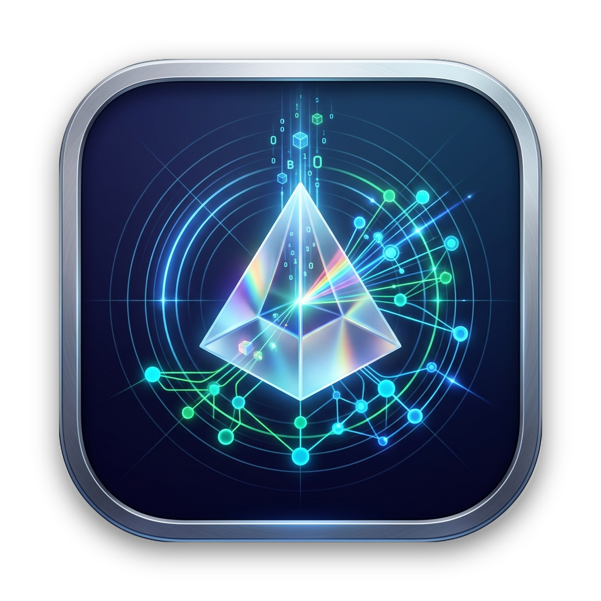

<div align="center">
  
  <h1>HQ Network Debugger & MapLocal Mock</h1>
  <p>一款基于 <b>Node.js + Mockttp + Vue 3</b> 构建的跨平台网络抓包、HTTPS 解密透视与 <b>Map Local (接口 Mock)</b> 桌面端调试工具。</p>
  <p>兼具 Charles 的 <b>Structure / Sequence 双视图架构</b> 与现代 DevTools 的 <b>深浅双主题交互体验</b>，支持 Web 控制台、<b>Tauri 超轻量桌面包</b> 与 <b>Electron 桌面包</b> 多形态运行。</p>
</div>

---

## ✨ 核心特性与设计亮点

### 1. 🌐 全协议抓包与 HTTPS 流量透视
- **现代协议支持**：基于 `mockttp` 核心引擎，完整支持 **HTTP/1.1**、**HTTPS (MITM 动态签发)**、**HTTP/2 (h2)** 与 **WebSocket** 流量实时拦截与明文解析。
- **用户级持久化数据隔离 (`~/.hqnetwork/`)**：
  - 自动在用户主目录 `~/.hqnetwork/certs/` 生成并持久化保存 `HQ Network Debug CA` 根证书（`ca.pem` / `ca.crt` / `ca.key`）。
  - 自动在 `~/.hqnetwork/data/rules.json` 持久化保存 Map Local 规则。
  - 即使作为打包后的 `.app` 运行在 macOS `/Applications` 只读目录下也能正常读写，升级或重装 App 永不丢失已信任的证书与 Mock 规则。

### 2. 🖥️ Charles 风格双视图 + 可拖拽分栏工作台
- **🌳 结构视图 (Structure View)**：按协议与域名自动聚合构建折叠目录树，清晰展示各域名及子路径下的请求分布与计数，摆脱杂乱刷屏。
- **📋 序列视图 (Sequence View)**：按时间先后平铺展示请求流，直观呈现状态码、请求方法、域名、路径、响应耗时、包体大小及 `⚡ MOCK` 命中标记。
- **🔍 多维实时过滤栏**：支持按 URL / 关键字检索、按请求类型（`All` / `XHR & Fetch` / `JS` / `CSS` / `Img` / `Doc` / `Mocked`）快速筛选。
- **📐 全向可拖拽分栏 (Resizable Split Panes)**：
  - **左右分栏**：自由拖拽调节左侧流量导航区与右侧详情检查器的宽度比例。
  - **上下分栏**：右侧详情区采用上下双面板设计（上半区 **Request 请求详情**，下半区 **Response 响应详情**），支持自由拖拽调节上下高度。
- **🔬 深度报文检查器**：
  - **Request 面板**：支持 `Overview`（全链路概览与耗时）、`Headers`、`Query`（自动解析 URL 参数表格）、`Body`（JSON 自动格式化 / Raw 切换）以及 **`cURL`**（一键复制完整可重放的 cURL 命令）。
  - **Response 面板**：支持 `Body`（JSON 语法缩进美化）、`Preview`（图片/HTML 预览）、`Headers` 与一键复制响应内容。

### 3. ⚡ 强大的 Map Local (本地接口 Mock) 引擎
- **右键一键 Mock**：在任意抓包记录上点击鼠标右键 -> 选择 **「⚡ Map Local (Mock 当前请求)」**，弹窗自动回填该请求的**方法、URL、真实状态码、响应头与格式化后的 JSON 响应体**。
- **4 种灵活匹配模式**：
  - `路径匹配 (忽略 Query 参数)`：自动剥离动态时间戳/签名等 `?query` 参数，按域名 + 路径稳定命中；
  - `精确匹配 (Exact URL)`：完整匹配包含查询字符串在内的 URL；
  - `包含匹配 (Contains)`：URL 包含指定关键字即命中；
  - `正则匹配 (Regex)`：支持复杂自定义正则表达式路由匹配。
- **复杂 Query 参数兼容**：底层采用自定义请求谓词 `matching((req) => ...)` 机制，彻底解决长查询参数（如 `?uid=...&session=...`）导致的路由注册异常，支持模拟自定义状态码（如 `500` / `403`）与网络延迟（`Delay ms`）。
- **可视化规则管理弹窗**：
  - 匹配 URL 采用最多两行展示、超出自动 `...` 截断（悬停可查看完整 URL）；
  - 操作列宽度固定，「编辑」与「删除」按钮上下居中排列，确保长 URL 下操作按钮永不被挤压遮挡；
  - 内置独立封装的通用二次确认弹窗组件 (`ConfirmModal`)，告别生硬的系统原生弹窗。

### 4. 🛠️ 贴心的顶部工具栏与系统集成
- **▶ 开始抓包 / ⏸ 暂停抓包**：放置在顶部「🌐 代理:」地址胶囊右侧，带实时呼吸灯状态指示。
- **🖥️ 一键系统全局代理 (System Proxy)**：自动识别并适配 **macOS (`networksetup`)**、**Windows (`RegEdit Internet Settings`)** 与 **Linux (`gsettings`)**。点击即可开启/关闭本机全局代理；应用关闭或异常退出时**自动还原系统代理设置**，杜绝关软件后电脑断网。
- **🔐 根证书安装向导 (`安装证书` 菜单)**：
  - 支持在 macOS 上**一键将根证书导入系统钥匙串并自动打开钥匙串访问**，配合图文指引 10 秒完成“始终信任”配置；
  - 提供直接下载 `ca.pem` / `ca.crt` 文件入口，解决开启系统代理后浏览器报 `NET::ERR_CERT_AUTHORITY_INVALID` 的问题。
- **📱 手机扫码配网向导 (`手机配网` 菜单)**：自动检测电脑局域网 IP 并生成证书下载二维码，附带 iOS 描述文件信任教程与 Android 证书安装指引。
- **🌙 深色 / ☀️ 浅色双主题切换**：位于顶部导航最右侧，全量 CSS 变量驱动（含弹窗卡片纯色背景防穿透设计），自动持久化保存用户主题偏好。

---

## 🚀 快速启动与开发调试

### 1. Web 控制台模式（纯 Node.js 运行）
```bash
# 安装依赖
npm install

# 启动代理内核 (默认端口 8888) 与 Web 控制台 (默认端口 8899)
npm start
```
启动后在浏览器访问：**`http://localhost:8899`**。

### 2. 桌面客户端开发调试
```bash
# 方式 A：使用 Tauri 原生窗口调试 (需安装 Rust 环境)
npm run tauri:dev

# 方式 B：使用 Electron 窗口调试 (免装 Rust)
npm run electron:dev
```

---

## 📦 桌面客户端打包方案（双轨独立架构）

本项目同时内置了 **方案 A（Tauri 边车架构）** 与 **方案 B（Electron 原生内嵌架构）** 两套完全独立的打包流水线，产物分别输出至 [`dist/方案A-Tauri/`](dist/方案A-Tauri) 与 [`dist/方案B-Electron/`](dist/方案B-Electron)，互不干扰。

| 评估维度 | **方案 A：Tauri (Sidecar 边车模式)** | **方案 B：Electron (内置 Chromium)** |
| :--- | :--- | :--- |
| **执行打包命令** | `npm run tauri:build` | `npm run electron:build` |
| **输出目录** | `dist/方案A-Tauri/` | `dist/方案B-Electron/` |
| **DMG 安装包体积** | **~45 MB**（超轻量，仅为 Electron 的 1/3） | **~128 MB** |
| **.app 解压体积** | **~140 MB** | **~290 MB** |
| **UI 渲染引擎** | macOS 原生 WebKit（免带浏览器内核） | 内置完整 Chromium 浏览器 |
| **运行时内存占用** | **40 ~ 70 MB**（极省内存） | **160 ~ 260 MB** |
| **进程生命周期安全** | Rust 信号通知 + `stdin` 内核管道断开双重防孤儿进程锁 | Electron `before-quit` / `window-all-closed` 自动清理还原 |

> 详细打包原理与配置文档请参考：[doc/pkg.md](doc/pkg.md)

### 更新应用图标
项目采用定制的 **3D 钛金光学棱镜** 高清透明圆角图标（母版位于 [`icons-design/icon-prism-3d.png`](icons-design/icon-prism-3d.png)）。如需重新生成全平台图标集（`.icns` / `.ico` / 多尺寸 `.png` / Web `favicon.png`），仅需执行：
```bash
npm run icon:gen
```

---

## 📱 电脑与手机 HTTPS 抓包配置指南

### 一、电脑本机抓包配置
1. 点击应用顶部导航栏的 **「🔐 安装证书」** 按钮。
2. 点击 **「🚀 一键导入证书并打开钥匙串 (macOS)」**（或手动下载 `ca.pem` 双击导入钥匙串）。
3. 在弹出的 macOS「钥匙串访问」中找到 **`HQ Network Debug CA`**，双击打开详情 -> 展开 **「信任 (Trust)」** -> 将「使用此证书时」设置为 **「始终信任 (Always Trust)」**，关闭窗口并输入开机密码保存。
4. 点击应用顶部的 **「🖥️ 系统代理」** 按钮切换至开启状态，即可直接抓取本机浏览器与桌面应用的 HTTPS 请求。

### 二、手机端 (iOS / Android) 抓包配置
1. **连接同一局域网**：确保手机与电脑连接同一个 Wi-Fi。
2. **配置手机 Wi-Fi 代理**：
   - 查看应用顶部导航栏显示的局域网代理地址（如 `🌐 代理: 192.168.1.100:8888`，点击可复制）。
   - 在手机 Wi-Fi 详情中将「HTTP 代理」设为「手动」，填入上述 **服务器 IP** 和端口 **`8888`**。
3. **扫码安装并信任证书**：
   - 点击应用顶部 **「📱 手机配网」** 按钮弹出二维码。
   - **iOS (iPhone/iPad)**：使用系统自带 **Safari** 扫码下载描述文件 -> 前往「设置 -> 已下载描述文件」安装 -> 前往 **「设置 -> 通用 -> 关于本机 -> 证书信任设置」**，开启 `HQ Network Debug CA` 的完全信任开关。
   - **Android**：使用浏览器扫码下载 `.crt` 证书 -> 前往「设置 -> 安全 -> 加密与凭据 -> 从存储设备安装 -> CA 证书」完成安装。

#### 💡 Android 7.0+ 高级免 Root 抓包方案（解决证书不信任与 SSL Pinning）
- **🚀 方案一（物理真机免 Root - 首选推荐）**：使用定制版 LSPatch 结合 AppProxy 分应用代理，无需虚拟机、免 Shizuku、自动绕过证书锁定与系统证书检查。
- **📦 方案二（轻量级系统容器虚拟机）**：使用开源两仪（Twoyi）免 Root 容器，原生开放 Root 权限与系统证书读写目录。

---

## 📂 项目目录结构

```text
HqNetworkPacketCapture/
├── dist/                             # 桌面端打包产物目录（按方案独立隔离）
│   ├── 方案A-Tauri/                  # Tauri 打包产物 (.app & .dmg, ~45MB)
│   └── 方案B-Electron/               # Electron 打包产物 (.app & .dmg, ~128MB)
├── doc/
│   ├── 安卓免root抓包配置.md         # 安卓免 Root 真机 HTTPS 抓包配置实战全指南 (LSPatch 定制版 + AppProxy)
│   ├── tuoyi虚拟机抓包配置.md        # 两仪 (Twoyi) 容器虚拟机 HTTPS 抓包实战指南
│   ├── 新架构设计.md                 # 项目全新功能与前后端架构设计方案
│   └── pkg.md                        # 桌面客户端与 CLI 打包方案架构设计文档
├── icons-design/
│   └── icon-prism-3d.png             # 3D 钛金光学棱镜 App 图标高清透明母版 (1024x1024)
├── src/                              # Node.js 代理与后端核心服务
│   ├── cert-manager.js               # Root CA 证书生成与 ~/.hqnetwork/certs 持久化管理
│   ├── proxy-server.js               # Mockttp 代理内核 (HTTPS MITM 解密、自定义谓词路由匹配)
│   ├── rule-manager.js               # Map Local 规则 CRUD 与 ~/.hqnetwork/data 持久化
│   ├── system-proxy-manager.js       # 跨平台系统全局代理接管与安全还原 (macOS/Win/Linux)
│   └── web-server.js                 # Express API + WebSocket 实时流量广播服务
├── public/                           # Vue 3 模块化前端控制台 (ES Modules 零构建架构)
│   ├── index.html                    # Web 控制台主页面
│   ├── favicon.png                   # 网页端应用图标
│   ├── style.css                     # 深色/浅色双主题样式表与响应式分栏布局
│   ├── vendor/                       # 本地内置 Vue 3 运行时 (100% 离线可用)
│   └── js/
│       ├── app.js                    # 前端主入口与拖拽分栏控制器
│       ├── store.js                  # 全局响应式状态管理与 Actions (含异步 Confirm 队列)
│       ├── components/               # 模块化 UI 组件库
│       │   ├── AppHeader.js          # 顶部工具栏 (视图切换、录制开关、系统代理、主题切换等)
│       │   ├── LeftPanel.js          # 左侧面板 (多维过滤栏 + 视图容器)
│       │   ├── DomainTree.js         # Structure 域名目录树组件
│       │   ├── SequenceList.js       # Sequence 时间序列列表组件
│       │   ├── RightPanel.js         # 右侧上下可拖拽分栏详情容器
│       │   ├── RequestViewer.js      # Request 请求详情检查器 (Overview/Headers/Query/Body/cURL)
│       │   ├── ResponseViewer.js     # Response 响应详情检查器 (Body/Preview/Headers)
│       │   ├── ContextMenu.js        # 右键快捷上下文菜单
│       │   ├── MapLocalModal.js      # Map Local 规则创建与编辑弹窗
│       │   ├── RulesManagerModal.js  # Mock 规则列表管理弹窗 (两行截断 + 居中操作列)
│       │   ├── CertModal.js          # 电脑根证书一键安装与信任引导弹窗
│       │   ├── MobileModal.js        # 手机扫码配网与证书下载弹窗
│       │   └── ConfirmModal.js       # 通用自定义二次确认弹窗组件
│       └── utils/
│           ├── formatters.js         # 字节大小、耗时、JSON 格式化与 cURL 生成工具
│           └── treeHelper.js         # URL 解析与域名目录树构建算法
├── src-tauri/                        # 方案 A：Tauri (Rust) 桌面端工程与边车生命周期管理
├── electron-main.js                  # 方案 B：Electron 桌面端主进程入口
├── electron-builder.json             # 方案 B：Electron 打包配置文件
├── index.js                          # 独立服务与 Tauri 边车启动入口 (含管道安全停机锁)
└── package.json                      # 项目脚本与依赖配置
```
