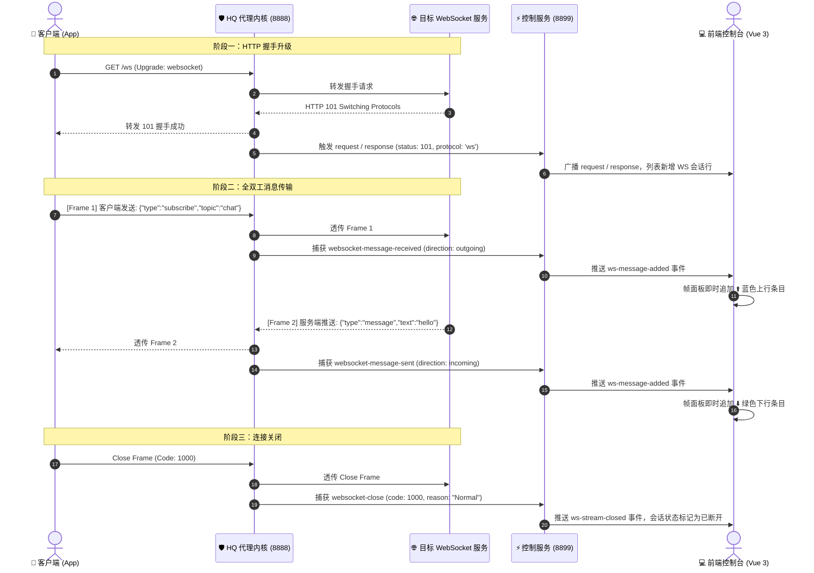

# WebSocket 全双工抓包与帧检查器 设计开发方案

本文档针对 **HQ Network Debugger & MapLocal Mock** 项目，详细阐述实现 **WebSocket (`ws://` 与 `wss://`) 全链路流量抓包、动态 MITM 解密、双向数据帧（Frames）实时捕获与 Charles / DevTools 风格可视化检查器** 的整体技术方案与分阶段落地规划。

---

## 目录
- [一、背景与需求分析](#一背景与需求分析)
  - [1. 当前现状与痛点](#1-当前现状与痛点)
  - [2. 目标与实现效果](#2-目标与实现效果)
- [二、整体系统架构与时序图](#二整体系统架构与时序图)
  - [1. 流量与事件流转拓扑](#1-流量与事件流转拓扑)
  - [2. WebSocket 全双工生命周期时序](#2-websocket-全双工生命周期时序)
- [三、核心数据模型与通信契约](#三核心数据模型与通信契约)
  - [1. 扩展 Transaction 结构体](#1-扩展-transaction-结构体)
  - [2. 帧数据结构 WebSocketMessage](#2-帧数据结构-websocketmessage)
  - [3. WebSocket 控制信道实时推送协议契约](#3-websocket-控制信道实时推送协议契约)
- [四、后端设计与实现细节（Node.js / mockttp）](#四后端设计与实现细节nodejs--mockttp)
  - [1. mockttp 规则注册（透传与拦截）](#1-mockttp-规则注册透传与拦截)
  - [2. 事件监听与方向归一化](#2-事件监听与方向归一化)
  - [3. 内存保护机制（防高频推送爆内存）](#3-内存保护机制防高频推送爆内存)
- [五、前端界面与交互设计（Vue 3）](#五前端界面与交互设计vue-3)
  - [1. 列表项标记（WS / WSS 专属徽章）](#1-列表项标记ws--wss-专属徽章)
  - [2. 详情区新增「💬 消息帧 (Messages)」面板](#2-详情区新增-消息帧-messages面板)
  - [3. 帧过滤器与自动滚屏控制](#3-帧过滤器与自动滚屏控制)
  - [4. 消息格式化预览（JSON / Raw / Hex）](#4-消息格式化预览json--raw--hex)
- [六、分阶段实施路线图](#六分阶段实施路线图)
- [七、关键技术挑战与避坑指南](#七关键技术挑战与避坑指南)

---

## 一、背景与需求分析

### 1. 当前现状与痛点
* **现状**：目前抓包内核仅监听常规 HTTP 请求与响应事件。当客户端发起 WebSocket 请求时，仅能捕获到最初的 `GET /path HTTP/1.1` 升级握手及服务端返回的 `101 Switching Protocols`。
* **痛点**：握手建立成功后，通道升级为全双工 TCP 长连接。由于缺少对 WebSocket 帧事件的订阅与广播，长连接内部的**客户端请求帧（Client Send ⬆️）**与**服务端推送帧（Server Push ⬇️）**对用户完全不可见，无法满足现代即时通讯（IM）、金融行情推流、实时协作以及消息推送等场景的调试需求。

### 2. 目标与实现效果
实现对齐 **Charles / Chrome DevTools** 体验的 WebSocket 专业级调试器：
1. **全协议覆盖**：完整支持明文 `ws://` 与基于 TLS 动态签发解密的 `wss://`；
2. **双向帧捕获**：清晰区分上行（Outgoing ⬆️，客户端->服务端）与下行（Incoming ⬇️，服务端->客户端）；
3. **报文类型识别**：支持识别文本帧（Text / JSON）、二进制帧（Binary / Buffer）、控制帧（Ping / Pong / Close）；
4. **实时推送流**：握手保持期间，每一条新帧微秒级推送到前端并高亮追加；
5. **深度报文查看**：点击任意帧可查看格式化后的 JSON、原始文本或 Hex 字节码；
6. **连接状态追踪**：准确显示连接时长、总收发帧计数、关闭状态码（如 `1000 Normal`、`1006 Abnormal`）与断开原因。

---

## 二、整体系统架构与时序图

### 1. 流量与事件流转拓扑

```
┌────────────────────────────────────────────────────────┐
│             客户端 (App / 浏览器 / 微信小程序)            │
└───────────────────────────┬────────────────────────────┘
                            │ 1. ws:// 或 wss:// 流量 (端口 8888)
                            ▼
┌────────────────────────────────────────────────────────┐
│             HQ 代理内核 (src/proxy-server.js)           │
│                                                        │
│  - mockttp.forAnyWebSocket().thenPassThrough()         │
│  - 动态 TLS 解密签发 (wss:// 转换为明文帧)                 │
│  - 监听事件:                                            │
│    * websocket-message-received (客户端发往服务端 ⬆️)    │
│    * websocket-message-sent     (服务端推往客户端 ⬇️)    │
│    * websocket-close            (连接关闭事件)          │
└─────────────┬────────────────────────────┬─────────────┘
              │ 2. 透明转发真实网络           │ 3. 内部事件派发 (EventEmitter)
              ▼                            ▼
┌───────────────────────────┐  ┌─────────────────────────┐
│     真实远端 WebSocket 服务 │  │  src/web-server.js      │
│   (如 wss://api.example)  │  │  (WebSocket 广播中心)    │
└───────────────────────────┘  └───────────┬─────────────┘
                                           │ 4. 实时广播帧数据 (端口 8899: /ws)
                                           ▼
                               ┌─────────────────────────┐
                               │  前端控制台 (Vue 3)      │
                               │  - SequenceList (WS 徽章)│
                               │  - WebSocketViewer 面板  │
                               └─────────────────────────┘
```

### 2. WebSocket 全双工生命周期时序



---

## 三、核心数据模型与通信契约

### 1. 扩展 Transaction 结构体
在 [`src/proxy-server.js`](../src/proxy-server.js) 的每条会话记录中，补充 WebSocket 专属状态字段：

```javascript
{
  id: "uuid-xxxx",
  protocol: "ws",            // 'http' | 'https' | 'ws' | 'wss'
  isWebSocket: true,         // 是否为 WebSocket 长连接
  wsState: "OPEN",           // 'CONNECTING' | 'OPEN' | 'CLOSED'
  wsMessages: [],            // 缓存的消息帧数组 (上限 1000 条)
  wsSentCount: 0,            // 累计发送帧数
  wsReceivedCount: 0,        // 累计接收帧数
  wsCloseCode: null,         // 关闭状态码 (如 1000)
  wsCloseReason: null        // 关闭原因
}
```

### 2. 帧数据结构 WebSocketMessage

```typescript
interface WebSocketMessage {
  id: string;               // 消息唯一标识 (msg-timestamp-index)
  streamId: string;         // 所属 Transaction 的 ID
  direction: 'outgoing' | 'incoming'; // outgoing: 客户端->服务端 (⬆️); incoming: 服务端->客户端 (⬇️)
  type: 'text' | 'binary' | 'ping' | 'pong' | 'close'; // 报文载荷类型
  timestamp: number;        // 捕获的时间戳 (ms)
  size: number;             // 字节长度
  payload: string;          // 文本内容或 base64/hex 字符串
  isJson: boolean;          // 是否为合法的 JSON 对象
  jsonPreview?: string;     // 若为 JSON，提取的核心摘要标签 (如 action/type)
}
```

### 3. WebSocket 控制信道实时推送协议契约

前端与后端建立在 `8899/ws` 的控制管道，新增两类专用事件：

#### (1) 产生新消息帧：`ws-message-added`
```json
{
  "event": "ws-message-added",
  "data": {
    "streamId": "c5f87b8d-xxxx",
    "message": {
      "id": "msg-1730000000-1",
      "streamId": "c5f87b8d-xxxx",
      "direction": "incoming",
      "type": "text",
      "timestamp": 1730101234567,
      "size": 128,
      "payload": "{\"event\":\"quote_update\",\"symbol\":\"AAPL\",\"price\":182.5}",
      "isJson": true
    }
  }
}
```

#### (2) 连接关闭：`ws-stream-closed`
```json
{
  "event": "ws-stream-closed",
  "data": {
    "streamId": "c5f87b8d-xxxx",
    "closeCode": 1000,
    "closeReason": "Client disconnected normally"
  }
}
```

---

## 四、后端设计与实现细节（Node.js / mockttp）

### 1. mockttp 规则注册（透传与拦截）
在 `applyRules()` 中，除了现有的 HTTP `forAnyRequest().thenPassThrough()` 外，显式注册 WebSocket 全量透传：

```javascript
// src/proxy-server.js
await this.server.forAnyWebSocket().thenPassThrough();
```

### 2. 事件监听与方向归一化
在 `_setupEventListeners()` 中订阅 mockttp 暴露的 WebSocket 生命周期事件：

```javascript
// 1. 客户端 -> 服务端（发送上行）
this.server.on('websocket-message-received', (msg) => {
  this._handleWsMessage(msg.streamId, msg, 'outgoing');
});

// 2. 服务端 -> 客户端（推送下行）
this.server.on('websocket-message-sent', (msg) => {
  this._handleWsMessage(msg.streamId, msg, 'incoming');
});

// 3. 连接关闭
this.server.on('websocket-close', (closeEvent) => {
  const tx = this.transactions.get(closeEvent.streamId);
  if (tx) {
    tx.wsState = 'CLOSED';
    tx.wsCloseCode = closeEvent.closeCode;
    tx.wsCloseReason = closeEvent.closeReason;
    this.emit('ws-stream-closed', {
      streamId: tx.id,
      closeCode: closeEvent.closeCode,
      closeReason: closeEvent.closeReason
    });
  }
});
```

### 3. 内存保护机制（防高频推送爆内存）
金融行情与弹幕等长连接每秒可能推送成百上千条消息，必须实施内存环形缓冲控制：
1. **单连接条目截断**：每个 WebSocket 会话的 `wsMessages` 数组最大保留 **1000 条**（先进先出 FIFO）；
2. **报文长度保护**：对单条超过 1MB 的超大文本或大文件二进制流进行截断显示，提供 `isTruncated` 标记；
3. **前端防抖渲染**：针对超高频消息流，前端使用 `requestAnimationFrame` 批量刷入 Vue 响应式队列，避免界面掉帧卡死。

---

## 五、前端界面与交互设计（Vue 3）

### 1. 列表项标记（WS / WSS 专属徽章）
- 在左侧 **SequenceList（序列视图）** 与 **DomainTree（结构树）** 中：
  - 如果请求的 `isWebSocket === true` 或响应码为 `101`，协议类型标签显示为亮紫色 **`WS`** 或 **`WSS`** 徽章；
  - 响应大小列显示为 `收 24 / 发 6` 帧计数提示。

### 2. 详情区新增「💬 消息帧 (Messages)」面板
当选中的请求是 WebSocket 时，右侧控制台不仅展示原有 Request Headers 与 Response Headers，并在详情面板中增加专属的 **`Messages`** 标签：

```
┌────────────────────────────────────────────────────────────────────────┐
│ 🌐 wss://chat.example.com/ws/live  [101 Switching Protocols]           │
├────────────────────────────────────────────────────────────────────────┤
│ [Overview] [Headers] [💬 Messages (128)]                              │
├────────────────────────────────────────────────────────────────────────┤
│ 🔍 过滤消息...  [全部] [⬆️ 发送] [⬇️ 接收]  [ ] 自动滚动  [🗑️ 清空帧]    │
├────┬────────────┬──────┬─────────┬─────────────────────────────────────┤
│ #  │ 方向       │ 长度 │ 时间    │ 消息数据内容摘要 (前100字符)           │
├────┼────────────┼──────┼─────────┼─────────────────────────────────────┤
│ 1  │ ⬆️ 发送    │ 64B  │ 15:42:01│ {"action":"login","token":"xyz..."} │
│ 2  │ ⬇️ 接收    │ 128B │ 15:42:01│ {"status":"ok","unread":3}          │
│ 3  │ ⬇️ 接收    │ 256B │ 15:42:05│ {"event":"chat","from":"jack"...}   │
│ 4  │ ⬆️ 发送    │ 8B   │ 15:42:10│ {"ping":1}                          │
│ 5  │ ⬇️ 接收    │ 8B   │ 15:42:10│ {"pong":1}                          │
└────┴────────────┴──────┴─────────┴─────────────────────────────────────┘
┌────────────────────────────────────────────────────────────────────────┐
│ [当前选中帧 #3 详情] (支持 JSON 格式化高亮 / 一键复制 / Raw / Hex)        │
│ {                                                                      │
│   "event": "chat",                                                     │
│   "from": "jack",                                                      │
│   "msg": "你好，测试 WebSocket 实时推送"                                 │
│ }                                                                      │
└────────────────────────────────────────────────────────────────────────┘
```

### 3. 帧过滤器与自动滚屏控制
- **方向快筛**：一键切换只看 `全部`、`仅看客户端发出的 (⬆️ Outgoing)`、`仅看服务端下发的 (⬇️ Incoming)`；
- **关键词搜索**：按输入内容动态过滤帧列表，快速锁定关键指令或响应；
- **自动滚屏 (Pin to Bottom)**：默认开启，实时追随最新帧；用户向上滚动浏览历史帧时自动暂停吸底，避免打扰阅读。

### 4. 消息格式化预览（JSON / Raw / Hex）
- **JSON 美化**：自动检测 `payload` 是否为合法 JSON，若是则使用带有颜色语法的折叠树格式化展示；
- **复制与导出**：一键复制当前帧完整内容。

---

## 六、分阶段实施路线图

| 阶段 | 核心任务 | 交付物 / 涉及文件 | 预期工期 |
| :--- | :--- | :--- | :--- |
| **阶段一：内核事件扩展** | 开启 mockttp 的 WebSocket 规则透传，监听消息与关闭事件，维护 `wsMessages` 内存队列 | `src/proxy-server.js` | 1 天 |
| **阶段二：通信与实时广播** | 在 `web-server.js` 中新增 `ws-message-added`、`ws-stream-closed` 广播，补充 REST 历史查询 API | `src/web-server.js` | 0.5 天 |
| **阶段三：前端组件与样式** | 新增 `WebSocketViewer.js` 独立子面板，支持帧列表、方向图标、自动滚屏与 JSON 查看器 | `public/js/components/WebSocketViewer.js`、`RightPanel.js`、`style.css` | 1.5 天 |
| **阶段四：全局联动与测试** | 列表 WS 徽章状态联动，搭建本地实时 WebSocket 客户端/服务端测试全链路抓包 | `SequenceList.js`、全链路联调验证 | 0.5 天 |

---

## 七、关键技术挑战与避坑指南

1. **WSS 证书动态解密**：
   - 客户端建立 `wss://` 连接时，首先经由 TLS 握手。由于底层 `mockttp` 已使用我们的 `HQ Network Debug CA` 根证书做 MITM 接管，TLS 解密后的 HTTP 升级请求会被自动识别并平滑升级，无需额外处理底层证书。
2. **连接关闭事件的延迟触发**：
   - 部分移动端 App 在切后台或弱网时直接强杀 TCP，不会发送优雅的 Close Frame（状态码 1000）。此时底层代理会触发套接字 reset 或 timeout，需要在 `client-error` 与 `tls-passthrough-closed` 中补充异常关闭兜底标记（`wsCloseCode: 1006 Abnormal`）。
3. **跨平台桌面端（Tauri）兼容性**：
   - 方案完全保持纯 Node.js / JavaScript 实现，Tauri 原生桌面端（方案 A）打包直接开箱可用，无需编译任何 C++/Rust 二进制插件，保持 100% 跨平台与易维护性。
