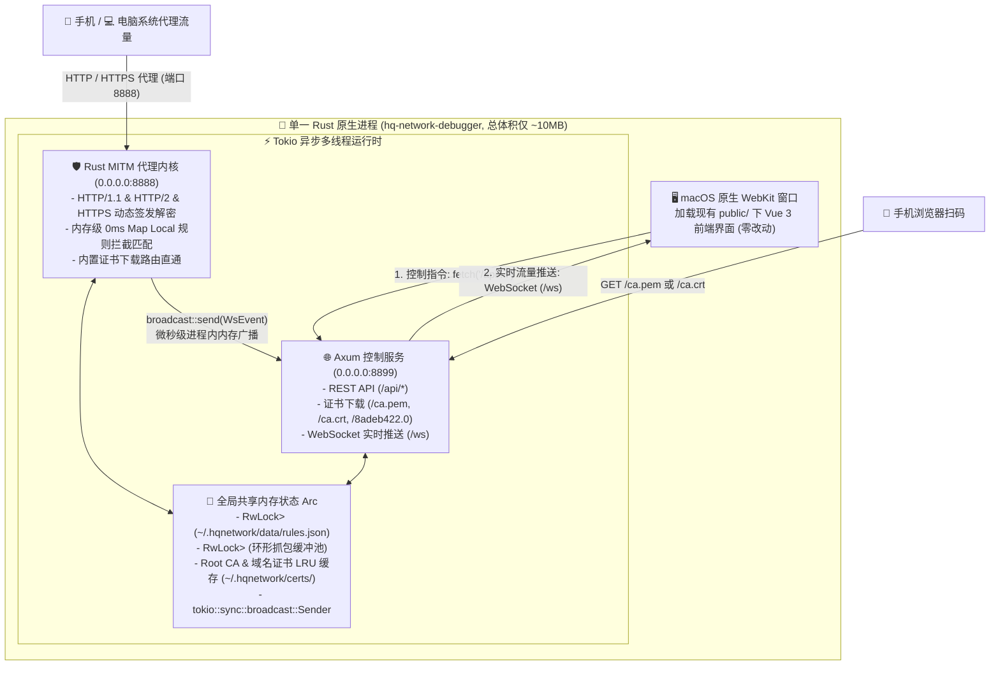

# 纯 Rust 内核 + Vue 3 前端 新架构设计方案 (Route 1)

本文档详细阐述 **HQ Network Debugger & MapLocal Mock** 的下一代轻量化架构演进方案（**路线 1：保留现有 Vue 3 前端界面 + 纯 Rust 原生重写代理与控制后端**），旨在将桌面安装包体积缩小 **90%**、消除边车子进程开销，并实现毫秒级规则热生效。

---

## 目录
- [一、背景与痛点诊断](#一背景与痛点诊断)
- [二、新架构全景设计](#二新架构全景设计)
  - [1. 架构拓扑图](#1-架构拓扑图)
  - [2. 三代打包架构核心指标对比](#2-三代打包架构核心指标对比)
- [三、前后端通信机制与契约（前端零改动）](#三前后端通信机制与契约前端零改动)
  - [1. 为什么在 Rust 中沿用 HTTP + WebSocket 协议？](#1-为什么在-rust-中沿用-http--websocket-协议)
  - [2. REST API 路由 1:1 映射表](#2-rest-api-路由-11-映射表)
  - [3. WebSocket (`/ws`) 实时广播消息契约](#3-websocket-ws-实时广播消息契约)
- [四、Rust 后端核心模块设计与技术选型](#四rust-后端核心模块设计与技术选型)
  - [1. 核心 Rust Crates 选型](#1-核心-rust-crates-选型)
  - [2. 模块一：`cert_manager.rs`（根证书与动态 MITM 签发）](#2-模块一cert_managerrs根证书与动态-mitm-签发)
  - [3. 模块二：`rule_manager.rs`（Map Local 规则引擎）](#3-模块二rule_managerrsmap-local-规则引擎)
  - [4. 模块三：`proxy_server.rs`（8888 端口 MITM 代理内核）](#4-模块三proxy_serverrs8888-端口-mitm-代理内核)
  - [5. 模块四：`web_server.rs`（8899 端口 Axum 控制与 WS 服务）](#5-模块四web_serverrs8899-端口-axum-控制与-ws-服务)
  - [6. 模块五：`system_proxy.rs`（跨平台系统代理与安全还原）](#6-模块五system_proxyrs跨平台系统代理与安全还原)
- [五、工程目录结构与多方案共存设计](#五工程目录结构与多方案共存设计)
- [六、分阶段实施路线图](#六分阶段实施路线图)

---

## 一、背景与痛点诊断

在现有的 **方案 A（Tauri + Node.js 边车）** 与 **方案 B（Electron）** 中，我们已经打磨出了一套交互完善的 Vue 3 前端工作台，但打包产物的体积仍然偏大。通过对现有 `.app` 产物进行解剖：

```text
方案 A：HQ Network Debugger.app (解压总占用 140 MB，DMG 约 45 MB)
├── 🦀 Tauri Rust 原生宿主与窗口外壳 (Contents/MacOS)          ───   9.9 MB (仅占 7.0%)
├── 🎨 Vue 3 前端全部组件与样式资源 (public/)                  ───   0.2 MB (仅占 0.1%)
└── 🟢 内置 Node.js 运行时 (87MB) + node_modules (41MB)      ─── 129.0 MB (高达 92.9%！)
```

### 核心痛点：
1. **体积瓶颈**：为了运行约 700 行的 Node.js 后端代码，被迫捆绑了近 **130 MB** 的 Node.js 运行时与依赖库。
2. **双进程通信与生命周期开销**：Tauri 主进程需要通过 `Command::new` 拉起独立的 `node` 子进程，轮询等待端口就绪，并通过信号与管道监控防止孤儿进程残留。
3. **规则重载开销**：`mockttp` 在每次增删改 Map Local 规则时，需要调用 `server.reset()` 清空并重新注册全部路由与事件监听器；而在高并发抓包时，Node.js 单线程事件循环与 V8 垃圾回收（GC）会带来额外内存与 CPU 开销。

### 重构核心思路：
既然 Tauri 宿主本身就是 **Rust**，我们可以直接将原本由 Node.js 承担的 5 个后端模块（共约 700 行代码）**原生内置到 Tauri 的 Rust 主进程中**，从而**彻底移除 129 MB 的 Node.js 运行时与 `node_modules`**，同时 **100% 保留现有的 Vue 3 前端界面**！

---

## 二、新架构全景设计

### 1. 架构拓扑图

重构后，整个应用收敛为**单一原生 Rust 进程**，内部通过 `tokio` 异步运行时并发驱动「MITM 代理引擎」与「Axum 控制服务」，并通过内存无锁/读写锁直接共享状态：



### 2. 三代打包架构核心指标对比

| 评估维度 | **方案 B：Electron** | **方案 A：Tauri + Node 边车** | **方案 C：纯 Rust 内核 + Vue 3 (本方案)** |
| :--- | :--- | :--- | :--- |
| **DMG 安装包大小** | ~128 MB | ~45 MB | **~4.5 MB（缩小 90%）** |
| **.app 解压后体积** | ~290 MB | ~140 MB | **~10 MB（减少 130 MB）** |
| **进程模型** | 多进程 (Main + Renderer + GPU) | 双进程 (Rust 宿主 + Node 边车) | **单一原生进程（零子进程管理负担）** |
| **冷启动速度** | 2.0 ~ 3.5 秒 | 1.2 ~ 2.0 秒（需等 Node 启动） | **0.1 ~ 0.2 秒（原生秒开）** |
| **空闲内存占用** | 160 ~ 260 MB | 80 ~ 140 MB | **25 ~ 45 MB** |
| **Mock 规则生效耗时** | 需 `mockttp.reset()` 重建规则 | 需 `mockttp.reset()` 重建规则 | **0 ms（直接更新内存 `RwLock`）** |
| **前端代码改动量** | 0 行 | 0 行 | **0 行（100% 复用现有 `public/`）** |

---

## 三、前后端通信机制与契约（前端零改动）

### 1. 为什么在 Rust 中沿用 HTTP + WebSocket 协议？
1. **前端 `public/` 100% 零改动**：现有的 [`store.js`](../public/js/store.js) 与 12 个 Vue 3 组件全部基于标准 `fetch('/api/...')` 与 `new WebSocket('ws://.../ws')` 编写。由 Rust 的 `axum` 框架原位接管 `8899` 端口后，前端无需修改一行代码即可无缝运行。
2. **天然支持手机局域网扫码下证书**：手机与电脑不在同一台设备上，手机扫码访问 `http://<电脑IP>:8899/ca.pem` 必须依赖局域网 HTTP 服务，`axum` 同时服务于本地 WebView 与局域网手机。
3. **支持外部浏览器协同调试**：除了桌面 App 窗口外，开发者依然可以在 Chrome 浏览器中打开 `http://localhost:8899` 同步查看抓包台。

### 2. REST API 路由 1:1 映射表

Rust `axum` 服务端完整实现以下与原 Node.js `web-server.js` 完全一致的路由：

| 分类 | 方法 & 路径 | 功能说明 |
| :--- | :--- | :--- |
| **静态资源** | `GET /*` | 托管 `public/` 目录下的 `index.html`、`style.css`、`js/*`、`vendor/*` |
| **证书下载** | `GET /ca.pem` / `GET /ca.cer` | 返回 `~/.hqnetwork/certs/ca.pem`（默认 `inline; filename="HQ-Network-Debug-CA.cer"` 触发 iOS 描述文件安装；带 `?download=1` 时作为附件下载） |
| **证书下载** | `GET /ca.crt` | 返回 `ca.crt`（`attachment; filename="hq-ca.crt"`，供 Android 安装） |
| **证书下载** | `GET /ca.0` / `GET /:hash.0` | 返回 Android 系统级证书（如 `8adeb422.0`，供 VMOS / Root 设备放入 `/system/etc/security/cacerts/`） |
| **证书管理** | `GET /api/cert/info` | 返回证书绝对路径与当前操作系统类型 `platform` |
| **证书管理** | `POST /api/cert/open-keychain` | macOS 调用 `open` 调起钥匙串访问；Windows 调起证书向导 |
| **配网二维码** | `GET /api/qrcode` | 生成并返回 `ios` (`/ca.pem`) 与 `android` (`/ca.crt`) 的 Base64 PNG 二维码 DataURL 及 `systemCertFilename` |
| **抓包控制** | `GET /api/status` | 返回代理端口、Web 端口、局域网 IP 列表、录制状态、请求数、规则数 |
| **抓包控制** | `POST /api/recording` | 切换开始抓包 / 暂停抓包状态并广播 `recording-toggled` |
| **抓包记录** | `GET /api/requests` | 获取最近抓包事务列表 |
| **抓包记录** | `DELETE /api/requests` | 清空抓包历史记录并广播 `history-cleared` |
| **Mock 规则** | `GET /api/rules` | 获取全部 Map Local 规则列表 |
| **Mock 规则** | `POST /api/rules` | 新增或复制规则，持久化至 `rules.json` 并广播 `rules-updated` |
| **Mock 规则** | `PUT /api/rules/:id` | 编辑更新指定规则并广播 `rules-updated` |
| **Mock 规则** | `PATCH /api/rules/:id/toggle` | 切换规则启用/禁用状态并广播 `rules-updated` |
| **Mock 规则** | `DELETE /api/rules/:id` | 删除指定规则并广播 `rules-updated` |
| **系统代理** | `GET /api/system-proxy` | 获取当前系统全局代理状态 |
| **系统代理** | `POST /api/system-proxy/toggle` | 一键开启/关闭系统全局代理并广播 `system-proxy-changed` |

### 3. WebSocket (`/ws`) 实时广播消息契约

前端连接 `ws://127.0.0.1:8899/ws` 后：
1. **连接建立瞬间 (`init`)**：服务端立即下发当前快照：
   ```json
   {
     "type": "init",
     "data": {
       "requests": [...],
       "rules": [...],
       "isRecording": true,
       "proxyPort": 8888,
       "webPort": 8899,
       "lanIps": [{ "name": "en0", "ip": "10.10.206.99" }],
       "systemProxy": { "supported": true, "enabled": false, "service": "Wi-Fi", "server": "127.0.0.1", "port": 8888 }
     }
   }
   ```
2. **增量实时事件**：
   - `{"type": "request", "data": Transaction}`：新请求到达代理内核时触发；
   - `{"type": "response", "data": Transaction}`：目标服务器响应或命中 Map Local Mock 返回时触发；
   - `{"type": "history-cleared", "data": {}}`：清空列表时触发；
   - `{"type": "recording-toggled", "data": true | false}`：录制开关切换时触发；
   - `{"type": "rules-updated", "data": Vec<Rule>}`：规则增删改或开关变更时触发；
   - `{"type": "system-proxy-changed", "data": SystemProxyStatus}`：系统代理状态变更时触发。

---

## 四、Rust 后端核心模块设计与技术选型

### 1. 核心 Rust Crates 选型

| 功能领域 | 选用 Crate | 选型理由 |
| :--- | :--- | :--- |
| **异步运行时** | `tokio` (`full`) | Rust 工业级异步多线程运行时，支撑高并发网络代理与 Web 服务 |
| **HTTP / WS 服务** | `axum` + `tower-http` | Tokio 官方生态 Web 框架，内置原生 WebSocket 升级与静态文件服务 |
| **MITM 代理引擎** | `hudsucker` / `hyper` + `tokio-rustls` | 纯 Rust 高性能 HTTP/HTTPS MITM 代理库，原生支持 CONNECT 隧道劫持、TLS 动态握手与请求/响应拦截篡改 |
| **证书生成与签发** | `rcgen` + `time` | 纯 Rust 极速生成 Root CA 与动态签发域名 Leaf 证书，无需外部依赖 |
| **数据压缩解码** | `flate2` + `brotli` | 自动解压目标服务器返回的 `gzip`、`deflate`、`br` 压缩响应体为明文 |
| **正则与序列化** | `regex` + `serde` + `serde_json` | 高性能正则路由匹配与前后端 JSON 零成本序列化 |
| **二维码生成** | `qrcode` + `image` + `base64` | 纯 Rust 在内存中直接生成 PNG 格式的 Base64 DataURL 二维码 |

### 2. 模块一：`cert_manager.rs`（根证书与动态 MITM 签发）
- **存储路径**：继续沿用 `~/.hqnetwork/certs/`（`ca.pem`、`ca.crt`、`ca.key`、`8adeb422.0`）。
- **兼容已有证书**：
  - 启动时检测 `~/.hqnetwork/certs/ca.pem` 与 `ca.key` 是否存在且包含 `HqNetworkDebuger` 主体；
  - 若已存在，直接加载现有证书与私钥（**手机和电脑无需重新安装证书**）；
  - 若不存在，使用 `rcgen` 生成 `CN=HqNetworkDebuger, O=HqNetworkDebuger, C=CN` 的 Root CA。
- **Android 系统证书文件名计算**：计算 X.509 Subject 的 `subject_hash_old`（`8adeb422.0`），自动输出至证书目录。

### 3. 模块二：`rule_manager.rs`（Map Local 规则引擎）
- **数据结构定义**：
  ```rust
  #[derive(Debug, Clone, Serialize, Deserialize)]
  #[serde(rename_all = "camelCase")]
  pub struct Rule {
      pub id: String,
      pub name: String,
      pub enabled: bool,
      pub created_at: u64,
      pub updated_at: u64,
      pub r#match: RuleMatch,
      pub response: RuleResponse,
  }

  #[derive(Debug, Clone, Serialize, Deserialize)]
  #[serde(rename_all = "camelCase")]
  pub struct RuleMatch {
      pub method: String,     // "ALL" | "GET" | "POST" | ...
      pub match_type: String, // "exact" | "path" | "contains" | "regex"
      pub pattern: String,
  }

  #[derive(Debug, Clone, Serialize, Deserialize)]
  #[serde(rename_all = "camelCase")]
  pub struct RuleResponse {
      pub status_code: u16,
      pub status_message: String,
      pub delay: u64,
      pub headers: HashMap<String, String>,
      pub body: String,
  }
  ```
- **零延迟匹配**：代理线程直接读取 `Arc<RwLock<Vec<Rule>>>`，按序遍历 `enabled == true` 的规则，依次校验 `method` 与 4 种 `match_type`（`exact`、`path` 忽略 Query、`contains`、`regex`）。修改规则时直接更新内存锁并落盘 `rules.json`，无需重启代理服务。

### 4. 模块三：`proxy_server.rs`（8888 端口 MITM 代理内核）
- **请求拦截流程 (`handle_request`)**：
  1. **内置证书下载直通车**：若请求路径为 `/ca.pem`、`/ca.cer`、`/ca.crt`、`/ca.0` 或 `/[0-9a-f]{8}\.0`，直接返回本地根证书字节流，不经过外网转发。
  2. **录制与广播 (`request-received`)**：若 `is_recording == true`，构造 `Transaction` 存入环形队列（上限 1000 条），并通过 `broadcast_tx` 推送 `request` 事件至前端。
  3. **Map Local 规则命中检查**：
     - 若命中规则且配置了 `delay > 0`，执行 `tokio::time::sleep(Duration::from_millis(delay))`；
     - 构造预设的 `status_code`、`headers`（注入 `x-mocked-by: HqNetworkDebuger` 与 `x-mock-rule-id`）及 `body` 直接返回客户端，标记 `tx.is_mocked = true` 并广播 `response` 事件，不再请求真实服务器。
  4. **真实请求透传与响应解析 (`handle_response`)**：
     - 未命中规则时正常转发至目标服务器；
     - 收到响应后，自动根据 `Content-Encoding`（`gzip` / `br` / `deflate`）解压响应体用于前端明文展示，计算耗时 `duration` 并广播 `response` 事件。

### 5. 模块四：`web_server.rs`（8899 端口 Axum 控制与 WS 服务）
- 绑定 `0.0.0.0:8899`，提供上述全部 REST API 与 `/ws` WebSocket 端点。
- 静态资源托管：开发模式下直接挂载 `../public` 目录；生产打包模式下直接从 Tauri 资源目录（或编译期内嵌资产）提供服务。

### 6. 模块五：`system_proxy.rs`（跨平台系统代理与安全还原）
- 原生实现 `macOS` (`networksetup -setwebproxy` / `-setsecurewebproxy`)、`Windows` (`reg add`) 与 `Linux` (`gsettings`) 的代理开关。
- **单进程绝对安全清理**：由于代理与窗口处于同一个 Rust 进程，在 Tauri 的 `RunEvent::ExitRequested`、`RunEvent::Exit` 以及系统信号处理器中直接同步调用 `system_proxy::restore()`，100% 保证退出即还原系统网络。

---

## 五、工程目录结构与多方案共存设计

为方便直观对比 **方案 A（Tauri + Node 边车）**、**方案 B（Electron）** 与 **方案 C（纯 Rust 内核）**，工程采用独立模块组织，互不破坏：

```text
HqNetworkPacketCapture/
├── dist/
│   ├── 方案A-Tauri/                  # 现有 Tauri + Node 边车产物 (~45MB DMG)
│   ├── 方案B-Electron/               # 现有 Electron 产物 (~128MB DMG)
│   └── 方案C-PureRust/               # 新增：纯 Rust 内核产物 (~4.5MB DMG)
├── public/                           # 共享的 Vue 3 模块化前端界面 (三套方案共用，零改动)
├── src/                              # 原 Node.js 后端源码 (保留供 npm start 与方案 A/B 使用)
└── src-tauri/                        # Rust 工程目录
    ├── Cargo.toml
    └── src/
        ├── main.rs                   # 应用入口：启动 Tokio 代理/控制服务并打开 WebKit 窗口
        ├── state.rs                  # 全局共享状态 AppState 与数据结构定义
        ├── cert_manager.rs           # 根证书管理与 MITM 动态签发
        ├── rule_manager.rs           # Map Local 规则持久化与匹配引擎
        ├── proxy_server.rs           # 8888 端口 HTTP/HTTPS MITM 代理内核
        ├── web_server.rs             # 8899 端口 Axum REST API + WebSocket 广播服务
        └── system_proxy.rs           # 跨平台系统全局代理管理与退出自动还原
```

---

## 六、分阶段实施路线图

1. **阶段一：基础状态与存储层 (`state.rs` + `cert_manager.rs` + `rule_manager.rs`)**
   - 定义与前端 JSON 100% 对齐的 `Transaction`、`Rule`、`WsMessage` 结构体；
   - 实现 `~/.hqnetwork/certs/` 证书加载/生成与 `~/.hqnetwork/data/rules.json` 读写。
2. **阶段二：控制服务与系统代理层 (`web_server.rs` + `system_proxy.rs`)**
   - 使用 `axum` 实现全部 `/api/*` 路由、证书下载路由、二维码生成与 `/ws` 实时广播；
   - 实现系统全局代理一键切换与退出自动恢复。
3. **阶段三：MITM 抓包与 Map Local 代理层 (`proxy_server.rs`)**
   - 实现 `8888` 端口 HTTP/HTTPS 流量拦截、TLS 证书动态签发、压缩包体解码（Gzip/Brotli/Deflate）与 Map Local 规则毫秒级拦截响应。
4. **阶段四：剥离 Node 边车并独立打包验证 (`dist/方案C-PureRust/`)**
   - 移除 `tauri.conf.json` 中的 `backend` 边车资源捆绑；
   - 编译输出纯血 Rust 版本的 `.app` 与 `.dmg` 至 `dist/方案C-PureRust/`，进行体积、内存与全链路抓包 Mock 对比验证。
